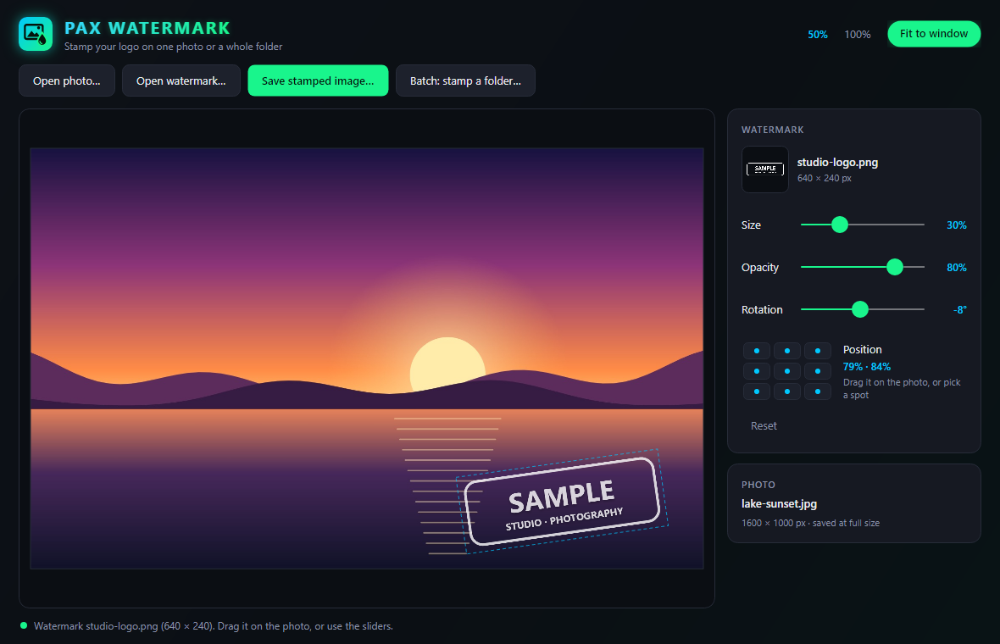

# PAX Watermark

**Stamp your logo on a photo, or on a whole folder of them.** A small Windows app: open a photo and a watermark image, drag the watermark where you want it, set its size, opacity and rotation, and save. The saved file keeps the photo's full resolution. Batch mode puts the same watermark in the same spot on every image in a folder.

<p align="center">
  
</p>

## Features

- **Drag to place.** Grab the watermark and move it, or click anywhere on the photo to drop it there. A dashed outline shows where it is.
- **Size, opacity and rotation** sliders, with the value next to each.
- **Nine quick spots.** Corners, edge middles or the center, a small margin in from the edge (rotation is taken into account, so a tilted logo doesn't poke out).
- **Zoom** with the mouse wheel, centered on the mouse. **Fit to window** scales the preview to the window; **100%** shows real pixels.
- **Full-resolution output.** The preview is just a preview: saving redraws the watermark onto the original pixels, whatever the zoom.
- **Placement that fits any size.** Position and size are stored relative to the photo (the watermark's width is a share of the photo's width), so a batch of landscape, portrait and square photos all get the logo in the same place.
- **Batch.** Pick a folder and every JPEG, PNG, WebP, BMP and GIF in it is stamped into a `watermarked` subfolder. The originals are never changed, and the watermark file itself is skipped if it sits in the same folder. A batch can be stopped halfway.
- **Keeps the format.** JPEG stays JPEG, PNG stays PNG, WebP stays WebP; BMP and GIF are saved as PNG, so the file name always matches what's inside.
- **Phone photos come out upright.** The EXIF orientation is applied when a photo is opened.
- **Remembers** the last folders, the watermark you used last time, and your size, opacity, rotation and position.

## Supported systems

| System | Status | Notes |
| --- | --- | --- |
| Windows 11, x64 | **Tested** | |
| Windows 10, x64 | Should work, untested | Nothing in the app is specific to Windows 11. |
| Windows on Arm | No download | May build from source with `-r win-arm64`; untested. |
| Linux, macOS | No download | Built with Avalonia, which runs there, but only Windows is built and tested. |

## Install (Windows)

**With [PAX Toolkit](https://github.com/joshpack/PaxToolkit):** turn on PAX Watermark there and it is downloaded and kept up to date for you.

**By hand:**

1. Install the **[.NET 10 Runtime](https://dotnet.microsoft.com/download/dotnet/10.0)** (x64) if you don't have it. The plain ".NET Runtime" is enough; the ".NET Desktop Runtime" includes it, so that works too.
2. Download **`PaxWatermark-1.0.0-win-x64.zip`** from **[the latest release](https://github.com/joshpack/pax_watermark/releases/latest)**.
3. Unzip it somewhere permanent, for example `%USERPROFILE%\Apps\PaxWatermark`.
4. Run `PaxWatermark.exe`. It doesn't need administrator rights.

The exe isn't code-signed, so SmartScreen may warn the first time: choose **More info → Run anyway**.

## How to use

1. **Open photo…** and pick the picture to stamp.
2. **Open watermark…** and pick your logo or signature. A PNG with a transparent background looks best.
3. Drag the watermark into place, or click one of the nine spots. Set **Size**, **Opacity** and **Rotation**.
4. **Save stamped image…** writes a copy at full size (named `<photo>_watermarked` by default). It won't overwrite the original photo.
5. For many photos: set it up on one of them, then **Batch: stamp a folder…** and pick the folder. The status line shows progress and where the copies went.

| Keys | What it does |
| --- | --- |
| <kbd>Ctrl</kbd> + <kbd>O</kbd> | Open a photo |
| <kbd>Ctrl</kbd> + <kbd>Shift</kbd> + <kbd>O</kbd> | Open a watermark |
| <kbd>Ctrl</kbd> + <kbd>S</kbd> | Save the stamped image |
| <kbd>Ctrl</kbd> + <kbd>0</kbd> | Fit to window |
| <kbd>Ctrl</kbd> + <kbd>1</kbd> | 100% |
| Mouse wheel | Zoom |

You can also start it with a photo: `PaxWatermark.exe "C:\Photos\beach.jpg"` (or use *Open with*).

## Settings file

Saved as JSON in `%APPDATA%\PaxWatermark\settings.json`: the last folders used for photos, watermarks, saving and batches, the last watermark file, `Size` (watermark width as a share of the photo's width, 0.02 to 1), `Opacity` (0 to 1), `Rotation` (degrees, -180 to 180), `CenterX` and `CenterY` (the watermark's center as a share of the photo's width and height) and `FitToWindow`. Delete the file to go back to the defaults. The environment variable `PAXWM_DATA` points the app at another folder instead.

## Self-test

```bat
PaxWatermark.exe --self-test C:\Temp\paxwm-test
```

Generates a made-up photo and logo in memory (no files of yours are read), stamps them one at a time and as a batch over three generated images (JPEG, PNG and WebP of different shapes), checks every output's size, format and that the watermark landed where it should, checks EXIF orientation handling and the settings file, and writes the results to `report.txt`. It also saves `window.png` and `window-empty.png`, pictures of the main window drawn off-screen, so nothing appears on your screen. Exit code 0 means everything passed. Settings go to a `data` folder inside the test folder unless `PAXWM_DATA` is set.

## Uninstall

Delete the app folder and `%APPDATA%\PaxWatermark`.

## Build from source

Windows with the [.NET 10 SDK](https://dotnet.microsoft.com/download/dotnet/10.0):

```bash
git clone https://github.com/joshpack/pax_watermark.git
cd pax_watermark
dotnet run
dotnet publish -c Release -r win-x64 --self-contained false -p:DebugType=none -o publish/win-x64
```

The version comes from `<Version>` in `PaxWatermark.csproj`. For a copy that doesn't need the .NET Runtime installed, use `--self-contained true` (a bigger download).

The exe's icon is `Assets/PaxWatermark.ico`, drawn by the app itself: `PaxWatermark.exe --write-icon Assets\PaxWatermark.ico` (give a `.png` path for a 256 px PNG instead).

## Code layout

| Path | What's there |
| --- | --- |
| `Program.cs` | Start-up, `--write-icon` and `--self-test` |
| `App.axaml(.cs)` | Theme and opening the main window |
| `Views/MainWindow.axaml(.cs)` | The window: toolbar, side panel, zoom, saving and batch |
| `Views/StampCanvas.cs` | The live preview and dragging the watermark |
| `Imaging/Stamper.cs` | Loading (with EXIF orientation), stamping and saving with Skia |
| `Imaging/Batch.cs` | Stamping a folder |
| `Services/AppSettings.cs` | Settings |
| `AppIcon.cs` | The app icon, drawn in code |
| `SelfTest.cs` | `--self-test` |
| `docs/` | The icon and the screenshot in this file |

Built with [Avalonia](https://avaloniaui.net/) 12 and SkiaSharp on .NET 10.

## Support development

If PAX Watermark is useful to you, you can support further development:

[](https://www.paypal.com/donate/?hosted_button_id=KQWZC2DC7Z7ZW)

## License

Open source and free to use under the MIT License.
